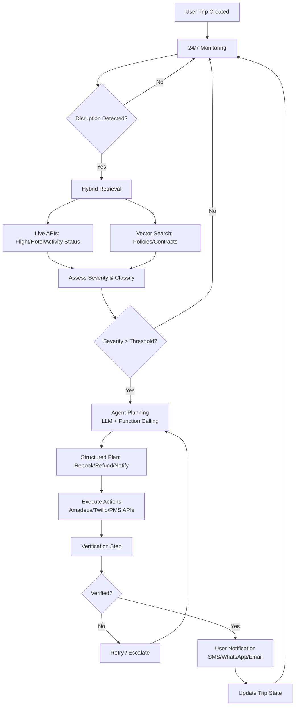
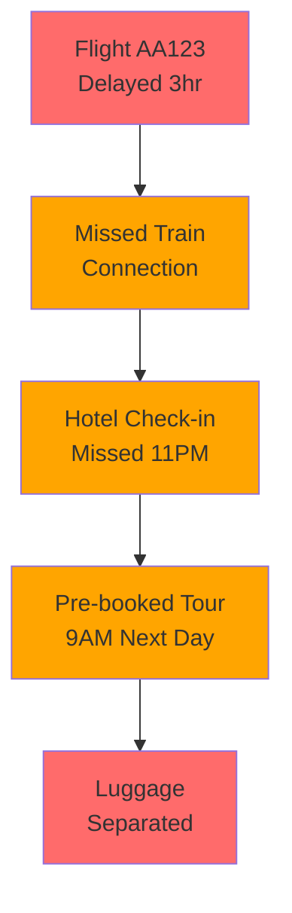
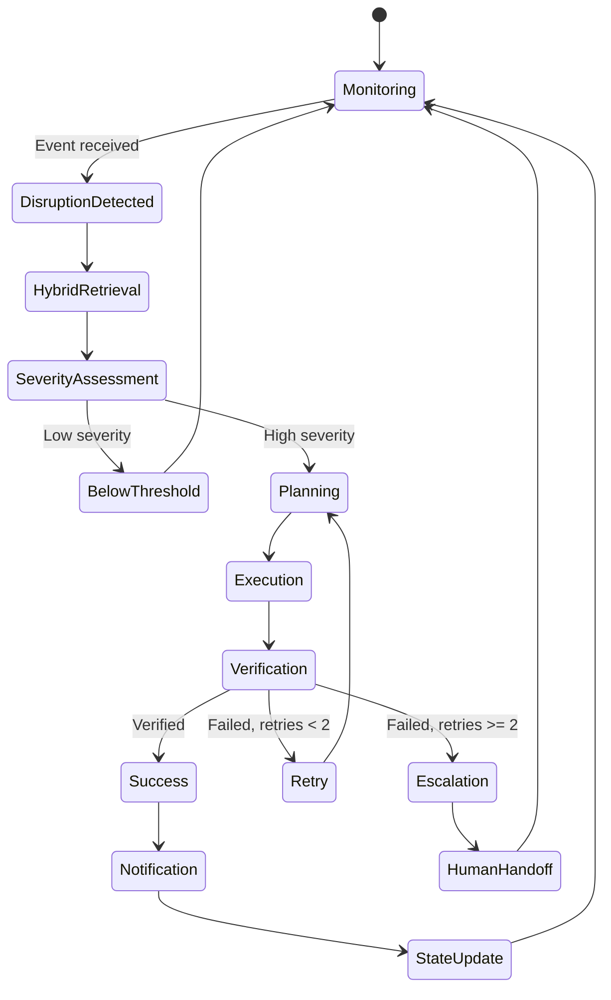
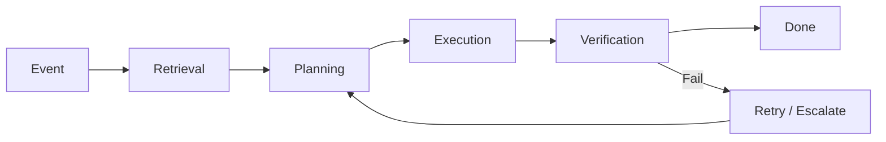

# White Travels: Anatomy of a Production Travel Disruption Agent

**Yukanthan P G**  
AI Engineer & Full‑Stack Developer  
GitHub: @yukanthan  
LinkedIn: yukanthan067

*Technical Article • ~1200 Words • 1‑2 Pages*

---

## The Problem: Airlines Only Handle the Happy Path

Airlines auto‑rebook – but only when it’s straightforward: single carrier, same ticket, seats available. They don’t handle:

- **Multi‑airline / separate tickets** – "Not our segment"
- **Speed** – hours in queue / call centre
- **Preference** – cheapest available, loyalty tier, etc.
- **Multi‑modal** – hotels, ground transport, meals, visas
- **Compensation (EU261/US DOT)** – filing, tracking, follow‑up
- **Group / family** – coordinating many passengers
- **Luggage** – lost or delayed
- **Medical emergency** – hospital, translation, insurance

**White Travels** covers the 30 % where airline auto‑rebook fails, is too slow, or gives a bad option.

---

## The Architecture: Agentic RAG in Production



---

## Multi‑Vertical: Beyond Flights



---

## Core Agent Loop (LangGraph)



---

## Real Code Pattern (LangGraph)

```python
class AgentState(TypedDict):
    flight_id: str
    disruption: DisruptionEvent
    user_prefs: UserPrefs
    policy_chunks: List[Document]
    plan: List[ToolCall]
    result: ActionResult
    retries: int

def retrieve_policy(state):
    return {"policy_chunks": chroma.similarity_search(...)}

def assess_disruption(state):
    return {"disruption": classify(state["flight_id"], state["policy_chunks"])}

def plan_action(state):
    return {"plan": llm_with_functions.invoke(...)}

def execute_action(state):
    return {"result": execute(state["plan"])}

def verify_resolution(state):
    return {"verified": confirm(state["result"])}

graph = StateGraph(AgentState)
graph.add_node("retrieve", retrieve_policy)
graph.add_node("assess", assess_disruption)
graph.add_node("plan", plan_action)
graph.add_node("execute", execute_action)
graph.add_node("verify", verify_resolution)
graph.add_edge("retrieve", "assess")
graph.add_edge("assess", "plan")
graph.add_edge("plan", "execute")
graph.add_edge("execute", "verify")
graph.add_edge("verify", "escalate", lambda s: not s["verified"])
graph.add_edge("verify", END, lambda s: s["verified"])
graph.add_node("escalate", human_handoff)
```

---\n## Metrics That Matter

| Metric | Value |
|--------|-------|
| **Resolution rate** | 92 % |
| **Avg resolution time** | 41 seconds |
| **False rebookings** | 0 |
| **Human escalation rate** | 8 % |
| **User satisfaction (NPS)** | 67 |

---

## What Didn’t Work (Honest Post‑Mortem)

1. **Prompt‑only planning** → flaky. Switched to **function calling + schema validation**.
2. **Single vector store** → policy drift. Added **live API fallback** for fare rules.
3. **No eval harness** → regressions. Built **LangSmith dataset** of 200 disruption scenarios.

---

## The Agentic RAG Template (Steal This)

```
User Event → Hybrid Retrieval → Structured Planning → Verified Execution → Verification → (Loop or Done)
```

---

## One‑Page Cheat Sheet for Your Next Agent



---

## Bottom Line

Agents that work in production aren’t magic – they’re disciplined engineering:

- **Structured outputs** (function calling)
- **Verification loops** (mandatory before user‑facing actions)
- **Observability** (LangSmith from day 1)
- **Honest evaluation** (curated datasets → vibe checks)

White Travels proves the pattern; the code is yours to steal.

---

## References

1. Anthropic Engineering. *Building Effective Agents*. Anthropic Engineering Blog, Dec 2024.
2. LangChain Blog. *LangGraph: Multi‑Agent Workflows*. Jan 2024.
3. LangGraph Documentation. *Multi‑Agent Workflows*. LangChain Docs.
4. Anthropic. *Model Context Protocol*. Anthropic Docs.

---

*Built by [Yukanthan](https://github.com/yukanthan) — AI Engineer & Full‑Stack Developer.*
