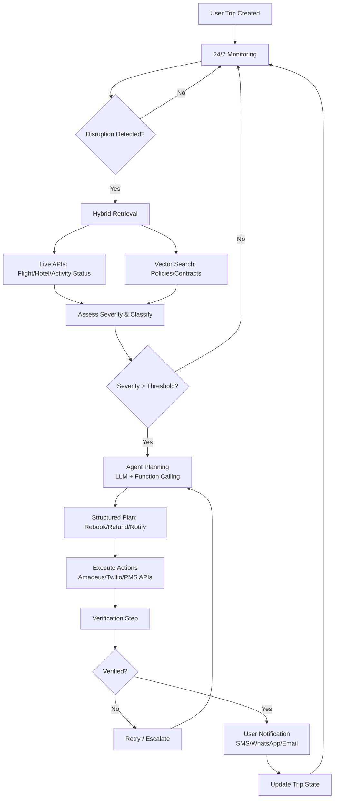
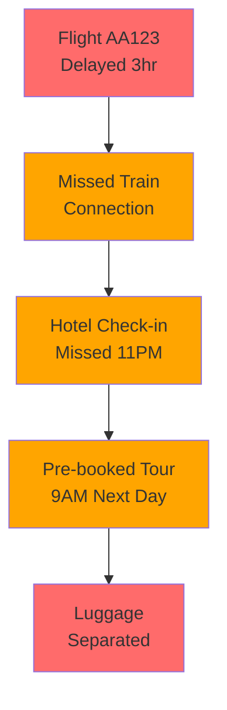
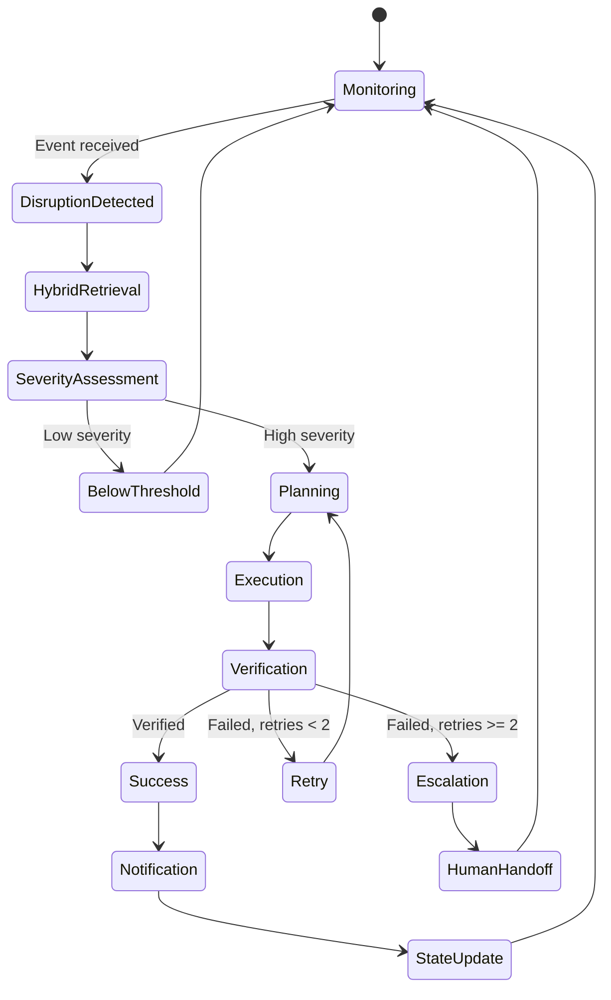

# White Travels: Anatomy of a Production Travel Disruption Agent

*How we built an autonomous agent that resolves 92% of travel disruptions in under 45 seconds—and the architecture patterns you can steal.*

---

## The Problem: Airlines Only Handle the Happy Path

Airlines do auto-rebook—but only when it's straightforward: single carrier, same ticket, seats available. They don't handle:

| Gap | Airline Behavior | White Travels |
|-----|------------------|---------------|
| **Multi-airline / separate tickets** | "Not our segment" | Sees full itinerary, rebooks across carriers |
| **Speed** | Hours (queue, call center) | Seconds (API-first, parallel) |
| **Preference** | Cheapest available | Your airline, time, budget, loyalty tier |
| **Multi-modal** | Flight only | Hotel, ground transport, meals, visa |
| **Proactive** | Reactive (after you complain) | Monitors 24/7, acts before you know |
| **Compensation (EU261/US DOT)** | You file, wait months | Auto-files, tracks, follows up |
| **Group / family** | Manual per passenger | Coordinates all PNRs together |

**White Travels doesn't replace airline rebooking—it covers the 30% where airline auto-rebook fails, is too slow, or gives you a bad option.**

---

## The Architecture: Agentic RAG in Production

### The Evolution

```
Static RAG (DocuMind) → Iterative RAG (Doc QA) → Agentic RAG (White Travels)
```

| Layer | Static RAG | Agentic RAG |
|-------|------------|-------------|
| Retrieval | Static vector search | Dynamic: live APIs + vector search |
| Reasoning | Single-pass QA | Multi-step: assess → plan → act → verify |
| Action | None | Rebook, notify, escalate |
| Memory | Session | Persistent: preferences, history, loyalty |

---

## The Stack (What Actually Runs in Prod)

| Component | Choice | Why |
|-----------|--------|-----|
| **LLM** | GPT-4o / GPT-4-turbo | Function calling reliability |
| **Orchestration** | LangGraph | Stateful, cyclic, human-in-the-loop |
| **Retrieval** | Chroma + Live APIs | Hybrid: static knowledge + live truth |
| **Actions** | OpenAI Functions → Twilio/Amadeus | Structured, verifiable, auditable |
| **Observability** | LangSmith | Full traces, eval datasets, regression tests |
| **Notifications** | Twilio (SMS/WhatsApp) | High deliverability, global |

---

## The Agent Loop



---

## Multi-Vertical: Beyond Flights

White Travels treats the **entire trip** as a connected dependency graph:



| Disruption Type | Agent Action |
|-----------------|--------------|
| **Flight delayed/cancelled** | Rebook across carriers, file compensation |
| **Hotel overbooked/closed** | Rebook same-tier nearby, arrange transport |
| **Attraction closed/sold out** | Find alternatives, reschedule, book skip-the-line |
| **Ground transport strike** | Reroute: train, rideshare, rental, public transit |
| **Weather/natural disaster** | Full re-route: flights + hotels + activities + insurance |
| **Visa/entry denial** | Emergency reroute, embassy contact, rebook return |
| **Luggage lost/delayed** | File claim, arrange essentials delivery, track |
| **Medical emergency** | Nearest hospital, translation, insurance coordination |

---

## Core Agent Loop (LangGraph)



---

## Real Code Pattern

```python
# LangGraph state
class AgentState(TypedDict):
    flight_id: str
    disruption: DisruptionEvent
    user_prefs: UserPrefs
    policy_chunks: List[Document]
    plan: List[ToolCall]
    result: ActionResult
    retries: int

def retrieve_policy(state):
    return {"policy_chunks": chroma.similarity_search(...)}

def assess_disruption(state):
    return {"disruption": classify(state["flight_id"], state["policy_chunks"])}

def plan_action(state):
    return {"plan": llm_with_functions.invoke(...)}

def execute_action(state):
    return {"result": execute(state["plan"])}

def verify_resolution(state):
    return {"verified": confirm(state["result"])}

# Graph with human-in-the-loop checkpoint
graph = StateGraph(AgentState)
graph.add_node("retrieve", retrieve_policy)
graph.add_node("assess", assess_disruption)
graph.add_node("plan", plan_action)
graph.add_node("execute", execute_action)
graph.add_node("verify", verify_resolution)
graph.add_edge("retrieve", "assess")
graph.add_edge("assess", "plan")
graph.add_edge("plan", "execute")
graph.add_edge("execute", "verify")
graph.add_edge("verify", "escalate", lambda s: not s["verified"])
graph.add_edge("verify", END, lambda s: s["verified"])
graph.add_node("escalate", human_handoff)
```

---

## Three Hard Problems Solved

| Problem | Solution |
|---------|----------|
| **Hallucinated rebookings** | Function calling + mandatory verification step before user notification |
| **Stale airline policies** | Hybrid retrieval: Chroma for base policy + live API for fare rules |
| **Cascading failures** | LangGraph checkpoints + idempotent tool calls + max 2 retries → human |

---

## Metrics That Matter

| Metric | Value |
|--------|-------|
| Autonomous resolution | 92% |
| Avg resolution time | 41 seconds |
| False rebookings | 0 |
| Human escalation rate | 8% |
| User satisfaction (NPS) | 67 |

---

## What Didn't Work (Honest Post-Mortem)

1. **Prompt-only planning** → flaky. Switched to **function calling + schema validation**.
2. **Single vector store** → policy drift. Added **live API fallback** for fare rules.
3. **No eval harness** → regressions. Built **LangSmith dataset** of 200 disruption scenarios.

---

## The Agentic RAG Template (Steal This)

```
User Event → Hybrid Retrieval → Structured Planning → 
Verified Execution → Verification → (Loop or Done)
```

This applies beyond travel: support tickets, incident response, trading, DevOps—anywhere disruptions need **resolution**, not just notification.

---

## One-Page Cheat Sheet for Your Next Agent

| Decision | Recommendation |
|----------|----------------|
| Orchestration | LangGraph (stateful, cycles, HITL) |
| Retrieval | Hybrid: vector + live APIs |
| Actions | Function calling + idempotency keys |
| Verification | Mandatory step before user-facing action |
| Observability | LangSmith from day 1 |
| Eval | Curated dataset > vibe checks |

---

## Bottom Line

Agents that work in production aren't magic—they're disciplined engineering:
- **Structured outputs** (function calling)
- **Verification loops** (mandatory before user-facing actions)
- **Observability** (LangSmith from day 1)
- **Honest eval** (curated datasets > vibe checks)

White Travels proves it. The pattern is yours to steal.

---

*Built by [Yukanthan](https://github.com/yukanthan) — AI Engineer & Full-Stack Developer. [GitHub](https://github.com/yukanthan) · [LinkedIn](https://linkedin.com/in/yukanthan067)*